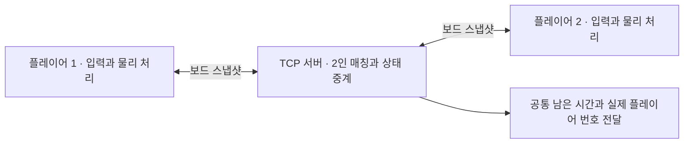

# TCP 멀티플레이 블록 게임

Win32 API와 Box2D로 만든 블록 쌓기 게임에 **WinSock2 TCP 서버**를 연결한 2인 대전 프로젝트입니다. 제한 시간 동안 상대보다 높은 탑을 쌓으며, 각 화면에서 자기 보드와 상대 보드를 함께 확인할 수 있습니다.

[포트폴리오 프로젝트 소개](https://github.com/mjcjc/Portfolio/blob/main/windows-tcp.md)

## 동작 흐름

각 클라이언트가 자기 보드의 입력과 물리를 처리합니다. 서버는 두 플레이어를 매칭하고, 받은 보드 스냅샷에 송신자의 플레이어 번호와 공통 남은 시간을 담아 상대에게 전달합니다.

## 해결한 문제

| 문제 | 해결 방식 |
| --- | --- |
| 상대 블록이 이전 위치로 돌아가 보임 | 수신 스레드에서 시퀀스 번호가 더 큰 스냅샷만 저장하고, 게임 스레드에서 상대 보드에 적용합니다. [수신 처리](Inversus/NetworkManager.cpp#L361-L365) · [게임 루프](Inversus/Scene.cpp#L671) |
| 두 화면에 서로 다른 승자가 표시됨 | 각 화면의 로컬·원격 보드 번호를 서버가 기록한 실제 플레이어 번호와 대응시킵니다. 클라이언트는 보드 비교 결과를 해당 번호로 변환해 승자를 표시합니다. [번호 전달](InversusServer/GameServer.cpp#L206) · [결과 표시](Inversus/Scene.cpp#L1060) |
| 수신·송신 호출 한 번에 패킷이 모두 처리되지 않을 수 있음 | 수신 버퍼에서 헤더의 크기를 기준으로 완성된 패킷을 꺼냅니다. 송신은 세션별 큐에 남은 전송 위치를 보관해 이어서 처리합니다. [수신 버퍼](InversusServer/ClientSession.cpp#L95) · [송신 큐](InversusServer/ClientSession.cpp#L46) |

## 코드 구성

| 경로 | 역할 |
| --- | --- |
| [InversusServer/GameServer.cpp](InversusServer/GameServer.cpp) | `select()` 기반 소켓 이벤트 처리, 2인 매칭, 보드 상태 중계 |
| [InversusServer/ClientSession.cpp](InversusServer/ClientSession.cpp) | 연결별 수신 버퍼, 패킷 경계 복원, 부분 송신 처리 |
| [Shared/PacketProtocol.h](Shared/PacketProtocol.h) | 서버와 클라이언트가 공유하는 패킷 정의 |
| [Inversus/NetworkManager.cpp](Inversus/NetworkManager.cpp) | 서버 접속, 스냅샷 전송 및 최신 원격 상태 보관 |
| [Inversus/Scene.cpp](Inversus/Scene.cpp) | 게임 루프에서 원격 보드 반영, 경기 종료 화면 표시 |

## 담당 작업과 검증

별도 TCP 서버의 역할과 수정 범위를 정하고, Codex를 활용해 패킷 생성부터 화면 적용까지의 경로를 분석하고 수정했습니다. 기존 Box2D 물리 동작을 유지하면서 네트워크 동기화와 결과 표시에 집중했습니다.

개발 당시 서버 하나와 클라이언트 두 개로 반복 플레이했습니다. Player 1과 Player 2가 각각 이기는 경우를 재현해 두 화면에 같은 승자 번호가 표시되는지 확인했습니다.

## 빌드 및 실행

Windows에서 Visual Studio 2022의 **C++를 사용한 데스크톱 개발** 워크로드와 Windows SDK를 사용합니다.

1. [Inversus.sln](Inversus.sln)을 열고 `Debug | x64`로 솔루션을 빌드합니다.
2. `x64/Debug/InversusServer.exe`를 먼저 실행합니다.
3. `x64/Debug/Inversus.exe`를 두 번 실행합니다. 클라이언트는 `127.0.0.1:9000`으로 접속합니다.
4. 두 클라이언트가 연결되면 서버가 경기 시작 신호를 보냅니다.
